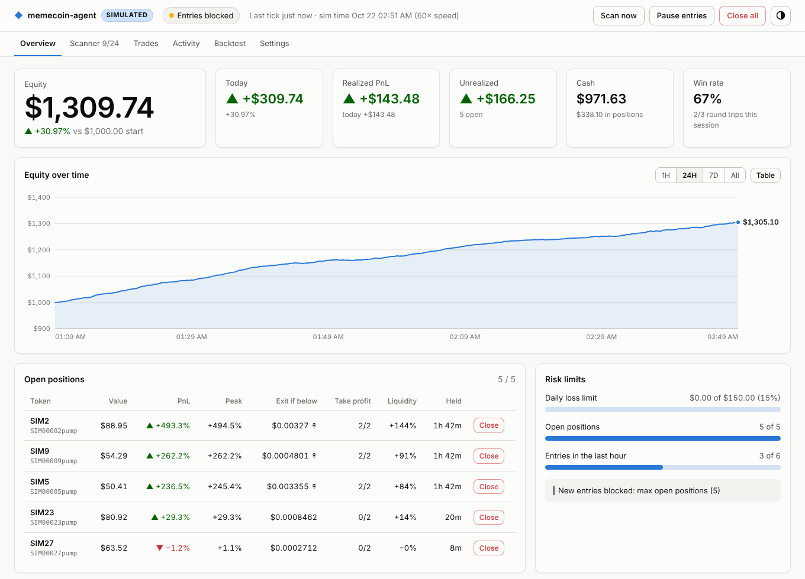

# memecoin-agent

An automated momentum trading agent for Solana memecoins. It finds new tokens on
DexScreener, screens out obvious rugs with RugCheck, enters tokens with real
liquidity and steady buy pressure, and exits on fixed rules. It **paper trades by
default**. Live trading goes through Jupiter and has to be switched on explicitly.

> **Read this first.** Most memecoins go to zero, and most automated memecoin
> strategies lose money once fees, slippage, MEV and rugs are counted. This is a
> framework with sensible guardrails, not a proven edge. Paper trade for at least
> a week of live market data before risking anything. If you go live, use a
> dedicated hot wallet that holds only what you can afford to lose.

## How it works

Each tick (10s by default):

1. **Mark & exit.** Re-price every open position and apply the exit rules, in this order:
   - **Liquidity pulled.** Liquidity falls ≥40% below its level at entry, which is the classic rug signature. Sell everything at once.
   - **Stop loss.** −25% from the effective entry price.
   - **Trailing stop.** Once the position has been +30% at its peak, exit if price falls 20% from that peak.
   - **Time stop.** Exit after 240 minutes.
   - **Staged take-profit.** Sell 40% at +50%, then 50% of what's left at +120%. A trailing stop rides the remainder.
2. **Scan & enter** (every 2nd tick, so every 20s):
   - Discover mints from three sources:
     - **Pump.fun graduations, in real time.** A background websocket to PumpPortal sees each token the moment it moves from the bonding curve to a real AMM pool. These go first in the scan.
     - DexScreener's latest-profiles and boost feeds.
     - Your `watchlist`.
   - Keep tokens that pass every filter:
     - liquidity, market cap and pair-age windows;
     - 1h volume, transaction count and volume/liquidity turnover;
     - buy/sell ratio over 5m and 1h;
     - positive 5m/1h momentum, but not already parabolic (>250% in 1h).
   - Rank the survivors by a 0–1 momentum score.
   - Run RugCheck on each one. A danger-level risk (live mint or freeze authority, unlocked LP, concentrated holders…) or a high risk score rejects the token. If RugCheck can't be reached, the token is rejected.
   - **Live only:** quote the buy, then quote selling the tokens straight back. Skip the token if that round trip loses more than 12%. This catches honeypots and thin routes.
   - Size the position: 5% of equity, capped at $100.
3. **Risk limits:**
   - at most 5 open positions;
   - at most 6 entries per hour;
   - a 3-hour cooldown per token after an exit;
   - new entries stop for the rest of the day once realized plus unrealized losses reach 15% of the day's starting equity;
   - a kill-switch file (`touch STOP`) stops new entries, while exits keep running.

Every parameter is in [`config.example.yaml`](config.example.yaml).

## Quick start

```bash
cd memecoin-agent
python -m venv .venv && source .venv/bin/activate
pip install -e '.[dev]'

memecoin-agent ui --synthetic --record   # try everything offline on a simulated market
cp config.example.yaml config.yaml
memecoin-agent -c config.yaml --record   # paper trade + record data + dashboard, one process
```

The bare command opens the dashboard (`memecoin-agent` is short for
`memecoin-agent ui`). One process runs the whole session:

```
                ┌──────────────── memecoin-agent (ui | run) ────────────────┐
 PumpPortal ws ─┤► launch feed ─┐                                          │
 DexScreener  ──┤► market data ─┼─► agent: exits → scan → RugCheck → buy ──┼─► paper fills / Jupiter swaps
 RugCheck     ──┤►──────────────┘        │                                 │
                │                 recorder (--record) ──► recordings/ ─────┼─► backtests (dashboard or CLI)
                │                 dashboard (ui only) ◄── views / controls │
                └───────────────────────────────────────────────────────────┘
```

- The trading loop, launch feed, recorder and dashboard share one set of data connections. The recorder samples right after each trading tick, inside the idle time, so it never delays an exit.
- `run` is the same engine without the web server. Use it on a server you only SSH into.
- A lock file stops a second trading process from starting on the same `state/`. That would double every order. A running dashboard therefore also blocks `close-all`; use its **Close all** button instead.

Other commands:

```bash
memecoin-agent -c config.yaml run --record   # same session, headless
memecoin-agent -c config.yaml status         # equity, PnL, open positions (read-only, safe anytime)
memecoin-agent -c config.yaml scan --safety  # what would it buy right now? (no trading)
memecoin-agent -c config.yaml backtest       # replay recordings (also in the dashboard)
memecoin-agent -c config.yaml record         # record only, without trading
memecoin-agent demo                          # synthetic market, text summary
```

State is written to `state/state.json` and every fill is appended to
`state/trades.csv`. Restarting picks up where the agent left off, including the
launch-feed buffer (`state/feed.json`) and the equity chart (`state/equity.csv`).

The `demo` market is synthetic and favourable by construction. It checks that
the plumbing and risk rules work. Its PnL tells you **nothing** about real
performance.

## GMGN: discovery and safety

With a [GMGN](https://gmgn.ai) API key the agent gets two more things. It only calls GMGN's read-only data endpoints; nothing here trades through GMGN.

- **Discovery:** GMGN's trending Solana tokens, refreshed every 2 minutes. They're pre-filtered on GMGN's side to the agent's own liquidity, market-cap and age window, and exclude wash-traded and non-renounced tokens. They're scanned after the pump.fun graduations and before DexScreener's lists. Prices still come from DexScreener, so filters, recordings and backtests use one data source.
- **Safety check:** runs after RugCheck and before LarpCheck, so a GMGN reject spends no LarpCheck credit. A token is skipped if any of these is true:

  | GMGN data | Skipped when |
  |---|---|
  | rug ratio | above 30% |
  | wash trading | detected |
  | top 10 holders | hold more than 35% |
  | dev team / creator | hold more than 10% |
  | suspected insiders | hold more than 15% |
  | bundler / insider trading volume | above 30% |
  | sell tax | above 10% |

  Optional rules, off by default: fresh-wallet share, serial deployers, and a minimum smart-money holder count. All are in the `gmgn:` section of the config.

**Setup** (on the machine that runs the agent; GMGN ties each key to a key pair made there):
1. `npx gmgn-cli config` prints a link. Open it and create the API key. Read-only access is enough.
2. `npx gmgn-cli config --apply <your key>` saves it to `~/.config/gmgn/.env`, which the agent reads. Or set `GMGN_API_KEY`.

Without a key the agent runs exactly as before. If GMGN is down or rate-limited, the other checks decide (`fail_closed: true` skips the buy instead), and discovery keeps the last trending list.

## LarpCheck gate

The last check before any buy is [LarpCheck](https://larpcheck.app). It investigates a coin's story (site, X account, claims) and its holders, and gives two verdicts:

- a story verdict: REAL … LIKELY LARP / LARP / SCAM;
- a coin stamp: OK / NEUTRAL / SKETCHY / **RIGGED**, a call on how fair the coin is for a buyer.

These catch what market data and RugCheck's summary miss. In the first live paper session, both tokens the agent bought had already been stamped RIGGED (linked wallets held 82% of supply; a 230-wallet farm held 30%). One dumped 99% three minutes after the buy. RugCheck had passed both.

- **Where it runs:** only on tokens that already passed every filter and RugCheck, so a few lookups a day. Looking up existing verdicts is free.
- **What it blocks:** a story verdict of LARP, LIKELY LARP or SCAM, or a RIGGED stamp (configurable). Bad verdicts block even when out of date: a rigged holder base stays rigged.
- **If a check is running:** the buy waits for the verdict (up to `pending_max_minutes`).
- **No verdict, no buy** (`require_verdict: true`, the default). A coin nobody has checked gets a check started (`on_unchecked: check`), spending one of your daily credits (`max_checks_per_day`). The agent buys only once the coin passes. When the credits run out, a check doesn't finish in `pending_max_minutes`, LarpCheck is unreachable, or there's no API key, the coin isn't bought.
- **Exits never depend on LarpCheck.** With `require_verdict: false` you can let the other checks decide instead (`on_unchecked: allow`, `fail_closed: false`).
- **In the dashboard:** the Scanner shows blocked coins as *Unsafe: larpcheck …* with an **evidence** link to the check's page. Coins it couldn't get a verdict for show as *No LarpCheck verdict: …*.

Create an API key at https://larpcheck.app/me. Provide it as `LARPCHECK_API_KEY`, or in `~/.config/larpcheck/api_key`. Without a key the agent opens no positions and logs an error; exits still run.

**Held coins.** LarpCheck keeps watching after a buy. Every 5 minutes it re-reads the verdict of each coin held (free). When a coin is flagged, the agent first reads LarpCheck's reasoning: the summary, the claim and whether it held up, each risk finding with its evidence, and what would change the picture. Then it sells:

| LarpCheck's view of a held coin | Action |
|---|---|
| LARP or SCAM | sell 100% |
| stamped RIGGED (any verdict) | sell 100% |
| LIKELY LARP stamped NEUTRAL or SKETCHY | sell 100% |
| LIKELY LARP stamped **OK**, and **never stamped RIGGED** in any check | sell 80%, keep 20% as dust |
| LIKELY LARP or LIKELY REAL and **anything changes** (a new check, a different verdict or coin stamp) | 80% + 20% dust if it's still LIKELY, stamped OK and never RIGGED; otherwise 100% |
| REAL / PARTLY REAL / UNCLEAR, or LIKELY REAL unchanged, and not RIGGED | hold |

- **Dust** gets no stop loss, take-profit or time stop, and it doesn't use one of the open-position slots. It's sold when you close it (the dashboard's **Close**, or **Close all**), or when it stops qualifying: a later check stamps it RIGGED or anything other than OK, or its verdict is no longer LIKELY LARP/LIKELY REAL. That's re-checked every 5 minutes, for free.
- **Where to read why:** the dashboard's positions table shows each coin's LarpCheck verdict, and the panel under it lays out why a coin was flagged. The trade journal records the verdict too.
- **Full reports:** they're open for checks you ran. For someone else's check, the free plan spends a credit to open it (`max_report_opens_per_day`); after that the agent uses the free headline and stamp line.
- **A held coin bought before it was checked** gets one check started for it.

The recorder keeps to RugCheck, so backtests don't replay LarpCheck verdicts yet.

## Dashboard

`memecoin-agent -c config.yaml ui` runs the same trading loop as `run`, plus a
local web dashboard at <http://127.0.0.1:8787>. It opens in your browser
automatically; `--no-browser` and `--port` change that.



- **Overview**:
  - equity, today's PnL, realized and unrealized PnL, cash and session win rate;
  - an equity chart (1H / 24H / 7D / All) with a hover readout and a table view;
  - open positions, with each one's current exit price, take-profit progress and liquidity change since entry, and a **Close** button;
  - how close you are to each risk limit;
  - recent trades.
- **Scanner**: every token from the last scan, with its score, key metrics and verdict. The verdict is *Bought*, *Passed filters*, *Unsafe: …* (the RugCheck reason) or the exact filters it failed. This is the place to tune your filters.
- **Trades**: the trade journal, with transaction links in live mode, a CSV download of the full history, and the saved hourly trade files.
- **Activity**: the agent's log, live, filterable to trades or to warnings.
- **Backtest**: pick a recording, enter `section.key=value` overrides, and get the report, equity curve, exit breakdown and every round trip. It runs on a copy of the config and never touches the live agent.
- **Settings**: the active config, read-only, with API keys masked.

Header controls:

- **Pause entries** stops new buys; exits keep running.
- **Close all** sells everything, after a confirmation.
- **Scan now** runs a scan immediately.

The dashboard reflects the live process, so stopping `ui` stops trading. Equity
history is saved to `state/equity.csv`, so the chart survives restarts.

**Security.** The dashboard can sell your positions, so:

- It listens on 127.0.0.1 only.
- Every API call needs a random per-session token that only the served page holds. Other websites can't trigger actions or read your data.
- It rejects requests addressed to any other hostname (blocking DNS-rebinding attacks).
- Other sites can't embed it in a frame (blocking clickjacking).

To reach it from another device, set `MEMECOIN_UI_PASSWORD` and pass `--host 0.0.0.0`. It refuses to bind publicly without a password. Put it behind HTTPS (for example, an SSH tunnel or a reverse proxy) before exposing it beyond your LAN.

## Trade files

Every fill is appended to `state/trades.csv` as it happens; that's the full history
(the dashboard's **Download CSV**, or `/csv` in Telegram). On top of that, every hour
the agent saves that hour's trades as their own file:

```
exports/trades_2026-10-22_1300-1400_UTC.csv
exports/trades_2026-10-22_1500-1600_UTC.csv     # no file for 14:00-15:00: no trades then
```

- Hours are UTC clock hours. An hour without trades gets no file.
- Hours missed while the agent was off are filled in on the next start (up to two days back).
- Download them from the dashboard (**Trades → Saved trade files**), or get each one in Telegram as it's written.
- Columns: time, side, mint, symbol, token amount, USD value, price, fee, reason, realized PnL, transaction signature (live mode).
- `export.every_minutes` changes the period (30 = half-hour files); `export.enabled: false` turns it off.

## Telegram bot

The agent can report to a Telegram chat and take commands from it: trade alerts as they happen,
each hourly trade file, and control from your phone.

**Set up** (once):

1. In Telegram, open **@BotFather**, send `/newbot`, pick a name and a username ending in `bot`.
   It replies with a bot token. Treat it like a password.
2. Give the agent the token: the `TELEGRAM_BOT_TOKEN` environment variable, or put it in
   `~/.config/memecoin-agent/telegram_token`.
3. Start the agent and send your bot any message. Until you're on its allowed list it answers only
   with your chat id. Set `TELEGRAM_CHAT_ID` to that number (several: comma-separated), or list it
   under `telegram.allowed_chat_ids`, and restart. The bot says "Agent started" in your chat.

**Commands:**

| Command | What it does |
|---|---|
| `/status` | Equity, today's PnL, positions used, whether entries are open, LarpCheck checks left |
| `/positions` | Each open position: value, PnL, time held, LarpCheck verdict, chart link |
| `/trades` | The last 10 trades |
| `/csv` | The full trade history as a CSV file |
| `/pause`, `/resume` | Stop or allow new buys (exits always keep running) |
| `/scan` | Scan for entries now |
| `/close SYMBOL` | Sell one position (the mint address works too) |
| `/closeall yes` | Sell everything, dust included |

**Safety:**

- Only allowed chats can use the bot; anyone else is told their own chat id and nothing more.
- Commands sent while the agent was off are dropped on start, so an old `/closeall` never fires later.
- `telegram.allow_controls: false` turns the bot into reports only.
- Messages are plain text, so token names from the market can't format or fake anything.
- The bot token never appears in logs.
- If Telegram is down or rejects the token, the agent keeps trading without it.

One bot token belongs to one running agent. If two copies use the same token (say, your PC and a server), only one
of them gets each command. The log then warns that another program is reading the bot's messages.

## Run it 24/7 in the cloud

To keep paper trading while your computer is off, run the agent on a server. The
[`Dockerfile`](Dockerfile) packages it for that:

- It runs headless (`run`) with [`deploy/server.yaml`](deploy/server.yaml), which is paper mode with the default strategy.
- Everything it keeps is written to `/data`: `state/` (portfolio, `trades.csv`, equity curve) and `exports/`.
- Keys come from environment variables; see [`.env.example`](.env.example).
- It shuts down cleanly when the host stops or redeploys it, saving its state first.

Telegram is your window into it: there's no web dashboard on the server.

**Railway** (no command line needed):

1. Sign in at railway.com with GitHub. Create a project with **Deploy from GitHub repo** and pick this repository.
2. In the service's settings, set **Root Directory** to `memecoin-agent` and the branch to deploy.
   Railway finds the Dockerfile.
3. Under **Variables**, add `TELEGRAM_BOT_TOKEN`, `LARPCHECK_API_KEY` and, optionally, `GMGN_API_KEY`.
4. Add a **Volume** to the service with mount path `/data`. Without it, every deploy starts a new paper wallet.
5. Deploy. Message your bot, add the chat id it replies with as `TELEGRAM_CHAT_ID`, and redeploy.

The service needs no public domain or port: the bot polls Telegram outward. Railway charges for a service that runs
all the time; check its current pricing.

**Any Linux VPS with Docker:**

```bash
git clone <this repo> && cd <repo>/memecoin-agent
cp .env.example .env && nano .env      # fill in the keys
docker compose up -d --build           # restarts by itself after crashes and reboots
docker compose logs -f                 # watch it
```

The server keeps its own paper portfolio, separate from your PC's. Two more things are shared between the copies:

- **LarpCheck's daily checks** come from the same key, so they're shared.
- **A Telegram bot token** belongs to one copy. Stop the agent on your PC, or give it its own bot.

To change the strategy on the server, copy settings from `config.example.yaml` into `deploy/server.yaml` and redeploy.

## Going live

1. `pip install -e '.[live]'` (adds `solders` for transaction signing).
2. Create a fresh wallet just for the bot, fund it with SOL, and export its key:
   - `SOLANA_PRIVATE_KEY`: a base58 string (Phantom export) or a JSON byte array, **or**
   - `SOLANA_KEYPAIR_PATH`: path to a `solana-keygen` JSON file.
3. In `config.yaml`:
   - set `execution.mode: live`;
   - set `execution.rpc_url` to a private RPC (Helius, Triton, QuickNode…). The public endpoint is rate-limited and slow.
4. `MEMECOIN_AGENT_CONFIRM_LIVE=yes memecoin-agent -c config.yaml run`

In live mode:

- Buys spend SOL. Cash is read from the wallet balance every tick, and `min_sol_reserve` (0.05 SOL) is always left for fees.
- Each swap is quoted by Jupiter, signed locally (the key never leaves the machine) and sent through your RPC.
- Fills are measured from on-chain balance changes, not from the quote.
- `memecoin-agent -c config.yaml close-all` sells everything immediately.

Known live-mode limitations:

- If a buy times out and lands later, the tokens sit in the wallet without being tracked. Check the wallet if you see `did not change ... balance` errors.
- The `status` command's "return vs start" figure compares against `starting_balance_usd`, not your real deposit.
- The launch feed only sees graduations that happen while the agent (or recorder) is running. Downtime leaves gaps, which DexScreener's feeds partly cover.

## Backtesting

Backtests replay real recorded market data through the exact production code
(agent, strategy, risk rules and paper fill model). So first, record. The easiest
way is to record while you paper trade: pass `--record`, set
`recorder.record_while_trading: true`, or click **Start recording** on the
dashboard's Backtest tab. To record without trading, use the standalone recorder:

```bash
memecoin-agent -c config.yaml record              # runs until Ctrl-C; --hours N to stop
```

The recorder polls discovery (DexScreener plus the launch feed) every 30 seconds.
It samples every discovered token for 12 hours, so a backtest sees what happened
after an entry, including for tokens your current filters would skip. It also
stores each token's RugCheck verdict. Output goes to gzipped hourly files in
`recordings/`. Run it on an always-on machine for a few days: hours of data are
noise.

Then replay it, changing parameters freely:

```bash
memecoin-agent -c config.yaml backtest
memecoin-agent -c config.yaml backtest --set filters.min_score=0.65 --set exits.stop_loss_pct=15
memecoin-agent backtest recordings/ --trades-out bt_trades.csv
```

```
Backtest 2026-01-01 00:00 -> 2026-01-01 23:59 UTC (24.0h, 283,215 records)
  Return          +93.50%   ($1,000.00 -> $1,934.99)
  Max drawdown    16.43%
  Round trips     68  (open at end: 0)
  Win rate        60.3%   avg win +55.9%   avg loss -32.1%
  Profit factor   2.58
  ...
  Exits           trailing stop: 31, stop loss: 22, time stop: 7, end of backtest: 5, liquidity pulled: 3
```

(That output is from the *synthetic* market, `record --synthetic`. Synthetic
sessions always write to `recordings-synthetic/`, so they never mix with real data. Use it to try the
workflow offline; its numbers mean nothing.)

**How faithful the replay is.** At simulated time T the agent sees only data
recorded at or before T:

- Discovery returns what discovery returned at the last recorded poll.
- A token that stopped being sampled looks unavailable, as it would live.
- Tokens with no recorded RugCheck verdict are rejected, as live (fail closed). `--assume-safe` overrides this.
- Open positions are sold at the last price when the replay ends. `--keep-open` leaves them open instead.

**What a backtest can't capture:**

- Price moves between 30-second samples. Stops fill at the next sample, which flatters them on fast dumps and rugs.
- Real slippage, MEV sandwiches and failed transactions.
- Your own buys moving the price. The fill model includes x*y=k price impact, but not other traders reacting.
- Tokens discovered 12h+ before they'd have been bought (outside `track_hours`).

Treat backtest results as an upper bound. Be wary of tuning parameters until one
recording looks great: hold some days back and check the result holds on them.

## Layout

```
memecoin_agent/
  agent.py           trading loop
  strategy.py        entry filters, momentum score, exit rules
  risk.py            sizing, exposure caps, daily loss halt, cooldowns
  portfolio.py       ledger, JSON state, CSV journal
  data/dexscreener.py, data/rugcheck.py
  data/gmgn.py       GMGN trending discovery + safety check (read-only API)
  data/larpcheck.py  LarpCheck pre-buy gate and held-coin reviews
  data/pumpportal.py real-time pump.fun graduation/launch websocket feed
  execution/paper.py     simulated fills (fees + x*y=k price impact)
  execution/jupiter.py   live swaps; execution/solana_rpc.py
  recording.py       market-data recorder (gzipped JSONL)
  backtest.py        point-in-time replay + performance report
  simulation.py      offline synthetic market for demo/tests
  ui/runner.py       the session engine for run + ui: agent loop, recorder, exports, controls, views
  export.py          hourly trade CSVs (exports/)
  telegram_bot.py    Telegram alerts, hourly CSVs and commands (Bot API long polling)
  statelock.py       one trader per state/ directory
  ui/server.py       stdlib HTTP server + auth; ui/static/ is the page (vanilla JS, no build)
tests/               pytest suite (HTTP and RPC mocked; real tx signing)
deploy/server.yaml   config for the Docker image (Dockerfile, docker-compose.yml)
```

Run the tests with `pytest`.
